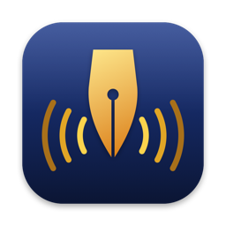
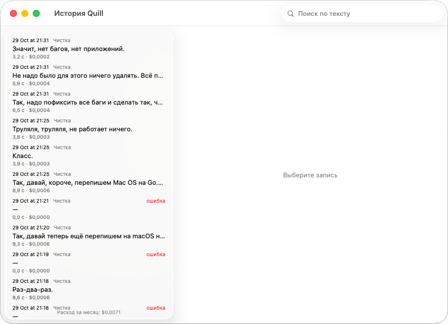
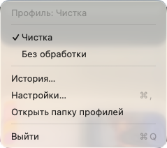
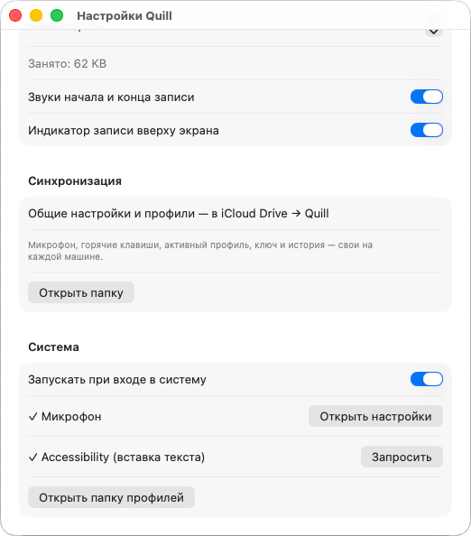

<div align="center">



# Quill

**Speak, and the text lands in the active window.**<br>
Menu bar dictation for macOS with LLM clean-up via OpenRouter.

[](https://github.com/isaldin/quill/releases/latest)
[](#homebrew)
[](https://github.com/isaldin/quill/releases)
<br>
[](#requirements)
[](https://www.swift.org)
[](https://openrouter.ai)
[](LICENSE)

</div>

Press a hotkey and speak. Quill transcribes your speech, cleans it up with an LLM and
pastes the result into the active window. Recognition and post-processing run through
[OpenRouter](https://openrouter.ai) with your own API key.

<p align="center">
  
</p>

> [!NOTE]
> The interface is currently in Russian only.

## Features

- **Global hotkey.** Hold ⌥Space to talk, or tap it to start and stop. Esc cancels.
- **Pastes where you are.** The result goes into the focused app (terminal, IDE, browser),
  and your clipboard is restored afterwards.
- **Profiles.** Plain Markdown files with per-project instructions, vocabulary and models.
  Switch with ⌥⇧P or from the menu; edits apply without a restart.
- **Nothing gets lost.** Every dictation is saved to a searchable history before any
  network request. If the API or network fails, you can re-transcribe it later.
- **Sync between Macs.** Profiles and shared settings live in iCloud Drive.
- **Cost tracking.** Each dictation shows its OpenRouter cost, plus a monthly total.
- **Recording indicator** at the top of the screen with level meter and timer.
  It does not take focus.

<p align="center">
  
</p>

## Requirements

- macOS 15 Sequoia or later, Apple silicon or Intel
- An [OpenRouter API key](https://openrouter.ai/settings/keys) with credits

## Install

### Homebrew

```bash
brew tap isaldin/tap
brew trust isaldin/tap   # Homebrew 7+ requires trusting third-party taps
brew install --cask quill
```

### Manual

Download `Quill-<version>.zip` from [Releases](https://github.com/isaldin/quill/releases/latest),
unzip it and move `Quill.app` to `/Applications`.

### First launch

Quill is signed but not notarized by Apple, so macOS blocks it on first launch. Either run

```bash
xattr -dr com.apple.quarantine /Applications/Quill.app
```

or try to open the app, then click **Open Anyway** in
*System Settings → Privacy & Security*. You only need to do this once per install.

## Setup

1. Open Quill. A waveform icon appears in the menu bar. Open **Settings…** from its menu.
2. Paste your OpenRouter key and click **Check**. The key is stored in the macOS Keychain.
3. Grant microphone access (asked on the first recording) and Accessibility access
   (needed to paste; use the **Request** button in settings).
4. Press ⌥Space and start talking.

If the menu bar icon is hidden (crowded menu bar or the notch), open Quill again from
Applications or Spotlight to bring up the settings window.

<p align="center">
  
  &nbsp;&nbsp;
  
</p>

| Action | Default shortcut |
| --- | --- |
| Record (hold to talk, or tap to start/stop) | ⌥Space |
| Cancel recording | Esc |
| Next profile | ⌥⇧P |

Shortcuts can be changed in settings. Without Accessibility access, Quill copies the
text to the clipboard and asks you to press ⌘V.

## Profiles

A profile is a Markdown file in `iCloud Drive/Quill/profiles/` (or
`~/.config/quill/profiles/` when iCloud Drive is unavailable). The file name is the
profile id. Two profiles are built in: raw (no post-processing) and clean-up.

```markdown
---
name: Frontend / Claude Code
transcription_model: openai/gpt-4o-transcribe   # optional
llm_model: openai/gpt-4.1-mini                  # optional
postprocess: true                               # false pastes the raw transcript
language: en                                    # optional
vocabulary:
  - useState
  - frontend-config
---
Post-processing instructions for this project.
```

The vocabulary is used only during post-processing: OpenRouter's transcription endpoint
does not accept hints.

The transcript is sent to the LLM as data, wrapped in a `<transcript>` tag, and the base
prompt tells the model not to follow requests inside it. Dictating "write a function
that…" into a chat with another assistant gives you clean text, not an answer.

## Sync between Macs

`settings.json` (models, audio limit, sounds, indicator) and `profiles/` are shared through
`iCloud Drive/Quill/`. Microphone, hotkeys, active profile, API key and history stay local
to each Mac.

On a second Mac, open *iCloud Drive → Quill* in Finder **before the first launch** and wait
until `settings.json` and `profiles/` have downloaded. Otherwise Quill creates its built-in
files and iCloud makes conflict copies (`settings 2.json`, `clean 2.md`) that you can delete.

## Data and privacy

| What | Where |
| --- | --- |
| OpenRouter API key | Keychain of this Mac, service `dev.saldin.quill`; never synced |
| History | `~/Library/Application Support/Quill/history.sqlite` |
| Audio recordings | `~/Library/Application Support/Quill/audio/` (rotated by size, 1 GB by default) |
| Shared settings and profiles | `iCloud Drive/Quill/` |

Audio and text are sent only to OpenRouter and the models you choose. Quill has no
telemetry.

## Building from source

You need Xcode 27, [XcodeGen](https://github.com/yonaskolb/XcodeGen)
(`brew install xcodegen`) and an Apple ID signed into Xcode. The project uses the Apple
Development identity; set `DEVELOPMENT_TEAM` in `project.yml` to your own team.

```bash
make test      # unit tests for the core logic (swift test, no Xcode project needed)
make install   # Debug build, copy to ~/Applications and launch
make release   # Release build → build/Quill-<version>.zip
```

`Quill.xcodeproj` is generated from `project.yml` and is not committed. All logic lives in
the `Core` Swift package and is covered by `swift test`; `App` is a thin AppKit/SwiftUI
layer. UI behaviour is checked manually against [docs/manual-checklist.md](docs/manual-checklist.md).

## License

[MIT](LICENSE)
